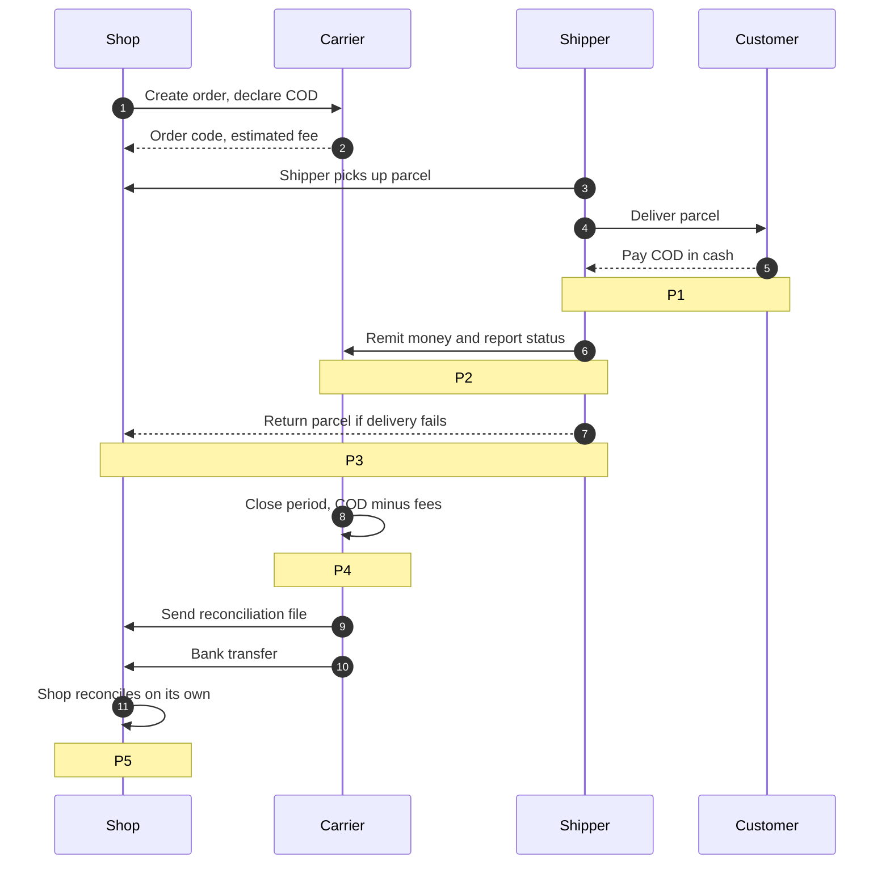
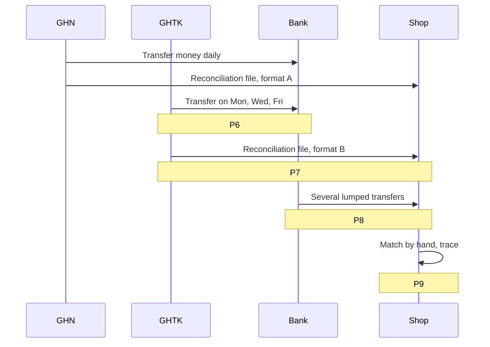

> Idea-lock document and input for the spec-writing step. It does not settle detailed
> technical choices or the version split. Translated from the original Vietnamese brief;
> the source wording is the author's intent, this file is its English record.

## 1. Overview

The system helps small and medium online shops that send COD parcels through several carriers know exactly where their money is, whether it has all arrived, what is wrong, and why. Reconciliation is the core; order, waybill, and status tracking are the foundation; a simulated wallet and risk scoring are extensions.

This is a practice project to grow software-engineering skill and financial-domain knowledge. It does not aim to compete with commercial products such as Sapo, Haravan, or Nhanh.vn.

## 2. Why this topic

### 2.1. Domain

| Domain criterion | Assessment |
|---|---|
| Always needed | Payments sit on a need that does not disappear: money must move, be collected on behalf of others, and be reconciled. The industry is tightly regulated, so it needs people who understand both the business and the engineering. |
| A fresher can get a foot in | The front door (banks, large wallets) is hard; the side door in practice is outsourcing for banks, small fintechs, and payment teams inside e-commerce/logistics. This topic suits both doors. |
| Common in Vietnam | COD is still common in e-commerce; banks, e-wallets, and logistics firms all hire IT. |

### 2.2. Against the topic-selection standard

| # | Standard | How this topic meets it |
|---|---|---|
| 1 | New in depth or in how it uses AI, not necessarily a new product | Reconciliation is the core rather than a side feature; the core is built in-house and measurable; AI explains discrepancies |
| 2 | Close to everyday life | Everyone has received a COD parcel; the problem is understood at once |
| 3 | AI is an assistive feature, separate from the core | AI reads unfamiliar files and explains discrepancies; with AI off the system still reconciles |
| 4 | Heavy load from data, with metrics | Continuous webhooks, large reconciliation files, matching lumped transfers against many orders |
| 5 | Full stack, cloud deployment | SaaS web app, background processing service, carrier simulators, deployed on AWS |
| 6 | Trains code review, testing, system design, observability, security | Money work demands invariant tests, idempotency, authorization, traceability |
| 7 | Built like a real SaaS, no interviewing, no monetization | Many shops, isolated data, authorization; desk research |
| 8 | Aimed at senior level, founder, indie dev | Owning the product end to end, making decisions and trade-offs, controlling running cost |
| 9 | Finance domain, common in Vietnam | Reconciliation, ledger, wallet, and payout are the core of banks and e-wallets |
| 10 | Has a write-up recounting the technical decisions | Decision records (ADR) throughout; a summary write-up after each version |

## 3. Context

One COD order with one carrier, from dispatch until the shop receives its money. Problems P1-P5 attach to the step where they arise.

When a shop uses several carriers at once, each carrier has its own reconciliation schedule (for example GHN reconciles daily, GHTK a few times a week). The diagram shows only the tail of the process, problems P6-P9.

## 4. Problem

| Code | Step | Problem |
|---|---|---|
| P1 | 5 | The cash the customer actually pays differs from the declared COD (price changed mid-way, customer got a discount, shipper collected the wrong amount) |
| P2 | 6 | Status updates are late or wrong; a delivered order is not recorded, so its money misses the reconciliation period and is left hanging |
| P3 | 7 | A returned order is charged a return fee, and may be lost; it is hard to know whether the returned goods have all come back |
| P4 | 8 | The actual fee differs from the estimate at step 2 (reweighing, remote-area surcharge); the shop only learns of it after being charged |
| P5 | 11 | Reconciling by hand order by order; errors accumulate, and complaint deadlines are easily missed |
| P6 | Multi-carrier | Payout schedules differ; no view of which carrier holds how much money in total |
| P7 | Multi-carrier | Each carrier has its own file format and fee naming; it must be normalized by hand |
| P8 | Multi-carrier | Money arrives in the account as lumped transfers; which transfer belongs to which order is unknown |
| P9 | Multi-carrier | Each carrier has its own deadline and complaint process; detecting a discrepancy late means losing the right to claim |

## 5. User and value

**User:** Owners of small and medium online shops that use two or more carriers, together with the staff and accountants in charge of orders and money.

**Value:** The shop always knows where its money is, whether it has all arrived, what is wrong, and why. Problems are found as they arise instead of at period close, and evidence is ready for a complaint before the deadline.

## 6. What is new

- **Depth:** reconciliation is the core, not a side feature of a sales suite; the core is built in-house, with measurable accuracy and performance.
- **AI:** understands reconciliation files in unfamiliar formats and explains in words why an order is off; it is an assistive feature only.
- **Simulated wallet and payout:** the system stands between carrier and shop to hold and release money, forcing every error to be caught at the source.

## 7. Scope

**Yardstick:** a part is included if the reconciliation core needs it to run end to end; it is not excluded merely because someone else already does it well. Development proceeds by version, from the core outward; each version's content is settled during spec writing.

| Group | Content |
|---|---|
| Core | Reconcile orders against money from carriers, detect and explain discrepancies, prepare complaint files |
| Necessary foundation | Basic order management, multi-carrier waybill creation, order status tracking, return confirmation |
| Extension | Per-shop wallet, hold money until reconciliation is done, payout (simulated); boom-order risk scoring (public data) |
| SaaS base | Many shops, each shop's data isolated, authorization |

## 8. Out of scope

| Item | Reason |
|---|---|
| Multi-marketplace (Shopee, TikTok Shop, ...) | The marketplace delivers and pays out itself; that is a different reconciliation process |
| Full warehouse | Reconciliation only needs to know that returned goods have come back |
| Accounting, tax | A step after reconciliation; only a data export is needed |
| Handling real money | Requires a payment-intermediary license; the wallet part is simulated only |
| Auto-filing complaints to carriers | Carriers rarely open this channel to outsiders |
| Integrations that need a partner contact | Anything requiring email, a phone call, or an approval wait (for example configuring GHN webhooks via support, a corporate bank account) is replaced with a simulator |

## 9. Feasibility and validation

**Integration principles**

- Use a real API when it is free, self-registerable, and needs no one to contact (for example a GHN staging account that can be created to make orders and compute fees with test data).
- Simulate the rest, staying close to the carriers' public API documentation: webhook format, status codes, reason codes, weight-change / fee / COD events.
- The core works only through adapters; it does not know whether it is talking to a real or a simulated carrier. No core function depends on an external system.

**Simulated components**

- **Carrier:** each carrier has its own behavior (period-close schedule, reconciliation file format, duplicate or out-of-order webhooks) and can be made to inject errors on demand.
- **Bank:** generates statements with lumped transfers.

**Validation, to avoid fooling ourselves**

- **Sourced anomaly catalog:** each anomaly type comes from a carrier's API documentation or reconciliation business documentation, with the source recorded.
- **Data generator kept separate from the engine:** the generator plants errors with an answer-key label; the engine does not know which errors were planted. Measure per error type, not as one aggregate number.
- **Invariant checks:** for example, money collected on behalf always equals fees plus money already transferred to the shop plus money still held. The invariant holds no matter how the data was generated.

## 10. Value-assessment criteria

> The project has value when it can present numbers, defend every decision, and prove that
> the money is never wrong.

The numbers below are targets, to be settled during spec writing.

### 10.1. For HR: answerable in 30 seconds

| Question | Expected answer | Metric (target) |
|---|---|---|
| What is new versus what exists? | Reconciliation is the core, AI explains discrepancies, wallet is simulated | - |
| What new technology is used? | Able to give the reason for each technology choice, not just list them | - |
| What are the results? | Concrete numbers, with before/after optimization | Reconcile N orders in X seconds; detection rate per error type >= Y%; webhook latency p95 < Z ms; AI cost per reconciliation file |

### 10.2. For a technical interviewer: dig anywhere and it holds

| Aspect | Evidence needed |
|---|---|
| Correct about money | Ledger, invariant checks, duplicate webhook does not create duplicate money |
| Decisions with reasons | Recorded context, options, trade-offs for each major decision |
| Honest validation | Measured on a sourced anomaly catalog, with simulation limits stated |
| Code quality | Meaningful tests, CI green, code reviewed |
| Actually runs | Demo link, usable right away |

### 10.3. For myself: how am I different after the project

| Capability | Sign of achievement |
|---|---|
| Business knowledge | Can explain reconciliation, ledger, and COD cash flow to someone outside the field |
| Operating a system | Have run it on the cloud, hit an incident, and handled it |
| Working with AI | Have recorded times AI wrote something wrong that I caught and fixed |

### 10.4. Signs the project has no value

- Can only recount features, not numbers or trade-offs.
- 100% accuracy on self-generated data that follows the engine's own rules.
- Many versions but none complete and demoable.
- Cannot answer "what if the webhook arrives twice?" or "what if money arrives before the status?".

## 11. Limits when presenting

- No real users.
- Carriers and the bank are mostly simulated from public API documentation; real APIs are used only where they are free and self-registerable.
- Accuracy is measured on a sourced anomaly catalog, not verified against production data.
- The wallet and payout are simulated only; no real money is handled.
