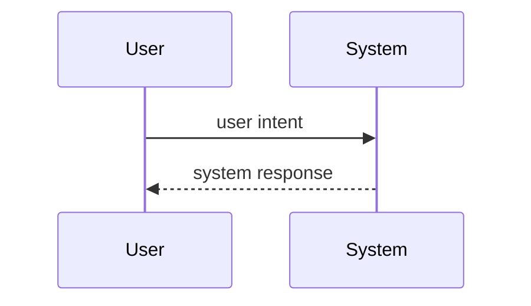

<!-- Use case mô hình hóa hành vi của product cho một mục tiêu của user, đạt được trong một lần ngồi (UCG-01).
     Viết theo docs/spec/_STYLE.md. Viết intent và response, không viết interface (rule 11, UCG-09).
     Interaction diagram là view được generate từ bảng Steps và Alternative flows; không sửa tay (MG-02). -->

## Interaction diagram

<!-- Generate từ bảng Steps và Alternative flows. Không sửa giữa hai marker. -->

<!-- BEGIN generated: use-case-sequence -->

<!-- END generated: use-case-sequence -->

## Steps

<!-- Bảng này là nguồn sự thật; diagram phía trên được generate từ nó. Mỗi step S1, S2, ... một dòng, theo thứ tự.
     User: intent ("Import a carrier statement"), không phải thao tác trên một control.
     System: điều user quan sát được; không có "if", không settings, không interface. Cite giá trị bằng [BR-xxx]/[NFR-xxx]; chưa viết thì dùng [BR-?: topic].
     FR: ID functional requirement cho response này, hoặc FR-? khi chưa có FR. Một response có thể có nhiều FR. Để trống khi step không cần FR riêng.
     Evidence: một tag từ _STYLE.md, chỉ khi step nhận định điều gì đó về product. Không thì để trống. -->

| Step | User | System | FR | Evidence |
|---|---|---|---|---|
| S1 |  |  | FR-? |  |

## Alternative flows

<!-- Mỗi alternative một block. ID ổn định, không bao giờ đánh số lại (UCG-06).
     At: step mà alternative bắt đầu, ví dụ "S3". Ends: một trong các giá trị:
       Back to Sx / Continue at Sx / Same step / End / To UC-xxx / To UC-? (topic)
     When: điều kiện hệ thống phát hiện được, hoặc một intent của user (UCG-04).
     Các field cố định theo thứ tự: At, Ends, When, System, FR. -->

### A1 · alternative name

- **At:** S?
- **Ends:** Back to S?
- **When:**
- **System:**
- **FR:** FR-?

## Situation and goal

<!-- Ai muốn gì, và vì sao là lúc này, bằng lời của user. Không có feature hay giải pháp (UCG-02). -->

## Trigger and precondition

<!-- Trigger: điều gì bắt đầu case. Precondition: điều gì đã đúng sẵn. Cả hai đều quan sát được, không settings, không interface. -->

- **Trigger:**
- **Precondition:**

## Outcome and minimal guarantee

<!-- Outcome: điều gì đúng sau khi thành công, kiểm chứng được bằng quan sát. Minimal guarantee: điều gì vẫn đúng sau khi bất kỳ nhánh nào thất bại (UCG-05). -->

- **Outcome:**
- **Minimal guarantee:**

## Product evidence

<!-- Chỉ ghi mức coverage: observed | none | unverified. Quan sát thô nằm trong docs/research/ (UCG-08).
     Khác biệt mô tả bằng văn xuôi, không bằng giá trị rule. Mỗi reference product một block. -->

### product name

- **Coverage:** unverified
- **Research link:**
- **Differences:**

## Open questions

<!-- Mỗi câu hỏi có "?". Bỏ section này nếu trống. -->

## Notes

<!-- Vì sao case này không trùng case khác; một lựa chọn design dưới dạng đề xuất ADR. Bỏ nếu trống. -->
