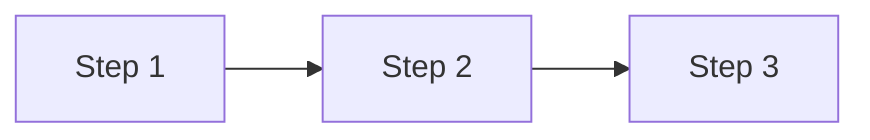

# Implementation plan — {scope}

<!-- Document rules (WORKFLOW.md "Document rules"): front-load the "At a glance" block,
     reference matrix rows and tests by id (don't restate them), keep the section order
     below, keep under ~1 page. -->

## At a glance

- **Use case:** UC-XXX
- **Steps:** S1-S2 (or "all")
- **Alternatives:** A1, A3 (or "all")
- **FRs in scope:** FR-NNN, FR-NNN
- **Decisions needed:** DEC-NNN, DEC-NNN
- **Status:** draft / reviewed / approved
- **Spine:** [traceability-matrix.md](./traceability-matrix.md) — every step maps to a row there

## Entry conditions

- [ ] All in-scope research tickets closed (Phase 1 gate)
- [ ] All in-scope test stub tickets closed (Phase 2 gate)

## Steps

### Step 1 — name

- **What to build:** module, function, file path to create or change
- **Tests it makes pass:** #N (AC test), #N (unit test)
- **Depends on decision:** DEC-NNN
- **Depends on step:** none
- **Ticket:** #N

### Step 2 — name

- **What to build:**
- **Tests it makes pass:** #N
- **Depends on decision:** DEC-NNN
- **Depends on step:** Step 1
- **Ticket:** #N

## Dependency diagram

## Approval

- [ ] Reviewed
- [ ] Approved — proceed to create tickets
